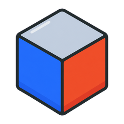

# Видовой куб для Renga



Плагин для **Renga**: плавающее окно с трёхмерным видовым кубом поверх интерфейса. Куб переключает камеру в 3D-виде — грань, ребро или угол задают направление взгляда.

**Разработчик:** Гаряев Иван Иванович  
**Версия:** 1.5.2.0  
**Тип плагина:** Net8

Версия в `src\ViewCubeOverlay\ViewCubeOverlay.rndesc` записана четырьмя числами (`1.5.2.0`). Так и должно оставаться: Renga не принимает версию из трёх частей.

## Возможности

- Поворот 3D-вида по граням, рёбрам и углам куба.
- Возврат к изометрическому виду кнопкой «домой».
- Отдельное перемещаемое окно, настройки масштаба, цветов и подписей.
- Сохранение настроек между запусками Renga.

Подходит для работы с информационными моделями зданий и других строительных объектов, включая коммерческие проекты.

## Как это работает

Плагин добавляет кнопку «Видовой куб (окно)» на основную панель и на панель действий 3D-вида. Кнопка активна только в трёхмерном виде.

По нажатию открывается отдельное окно WPF с кубом. Щелчок по грани, ребру или углу поворачивает камеру 3D-вида (`LookAt`) и сохраняет расстояние до модели. Кнопка «домой» ставит изометрию. Окно можно перетащить; положение, масштаб куба, цвета и то, было ли окно включено, записываются в `%AppData%\ViewCubeOverlay\settings.txt` и восстанавливаются при следующем запуске Renga.

Нативный навигационный куб Renga этот плагин не заменяет и не выключает: это отдельное окно поверх интерфейса.

## Требования

- Renga с API **2.48** или новее (`RequiredAPIVersion` в `ViewCubeOverlay.rndesc`).
- Плагин типа **Net8** (не .NET Framework).
- Для запуска собранного плагина на компьютере нужен **.NET 8** (целевая платформа проекта — `net8.0-windows`, x64).
- Для сборки — Visual Studio с MSBuild и поддержкой WPF. Команда `dotnet build` этот проект не собирает: ссылка на `RengaCOMAPI.tlb` — это COM-ссылка.

Проект самостоятельный. Его решение — `ViewCube.sln` в корне этого репозитория. Оно не входит в `Samples.sln` Renga SDK и не требует, чтобы исходники лежали в каталоге примеров SDK.

## Получение плагина

В репозитории опубликованы исходные файлы. Для установки соберите плагин по инструкции ниже; файлы Renga SDK необходимо получить отдельно. Перед использованием ознакомьтесь с [условиями лицензии](LICENSE.md).

## Сборка

1. Положите в папку `lib` два файла из установленного Renga SDK. В репозиторий они не входят: это файлы Renga Software, а не исходники плагина.

```text
lib\Renga.NET8.PluginUtility.dll    из <Renga SDK>\Net\
lib\RengaCOMAPI.tlb                 из <Renga SDK>\tlb\
```

Каталог по умолчанию задаёт свойство `RengaSdkLib` в `Directory.Build.props` — папка `lib` рядом с `ViewCube.sln`. Другой путь можно передать сборке: `/p:RengaSdkLib=C:\путь\к\папке\`.

2. Соберите `ViewCube.sln` в конфигурации Release, платформа x64, через MSBuild Visual Studio:

```text
MSBuild.exe ViewCube.sln /restore /p:Configuration=Release /p:Platform=x64
```

Готовые файлы плагина появляются в `bin\Release\ViewCubeOverlay\`: `ViewCubeOverlay.dll`, `ViewCubeOverlay.deps.json`, `ViewCubeOverlay.rndesc`, `icon.png` и служебные DLL сборки (`Interop.Renga.dll`, `Renga.NET8.PluginUtility.dll`). Папку `obfuscated` в каталог плагинов копировать не нужно. Если на машине есть пакет Obfuscar, сборка Release подменяет `ViewCubeOverlay.dll` обфусцированной копией; если пакета нет, в выход попадает обычная Release-сборка.

## Проверка сборки

После сборки Release можно проверить окно настроек без запуска Renga. Проверка создаёт окно в памяти, сверяет версию DLL с манифестом плагина и проверяет, что настройки отображаются без записи в пользовательский файл.

```powershell
MSBuild.exe tests\ViewCubeOverlay.Smoke\ViewCubeOverlay.Smoke.csproj /restore /p:Configuration=Release
.\tests\ViewCubeOverlay.Smoke\bin\Release\net8.0-windows\ViewCubeOverlay.Smoke.exe .\src\ViewCubeOverlay\ViewCubeOverlay.rndesc
```

Эта проверка не заменяет тестирование управления камерой и поведения окна в Renga.

## Установка

Скопируйте файлы из `bin\Release\ViewCubeOverlay\` (без папки `obfuscated`) в каталог плагинов своей Renga:

```text
<папка установки Renga>\Plugins\ViewCubeOverlay\
```

Перезапустите Renga. В 3D-виде нажмите «Видовой куб (окно)».

Чтобы MSBuild сам скопировал эти файлы, передайте каталог:

```text
/p:RengaPluginDeployDir=<папка установки Renga>\Plugins\ViewCubeOverlay\
```

В репозитории лежат исходники. Готовые файлы из папки `Plugins` установленной Renga сюда не входят.

## Состав

```text
ViewCube.sln
Directory.Build.props
README.md
LICENSE.md
TERMS.md
src\ViewCubeOverlay\    проект плагина: C# / XAML, ViewCubeOverlay.rndesc, icon.png
tests\ViewCubeOverlay.Smoke\  проверка Release-сборки и окна настроек
lib\                    справочные файлы SDK для сборки (см. выше)
```

Сборка и имя сборки остаются `ViewCubeOverlay`, поэтому имя установленного плагина не меняется.

## Условия использования

Правообладатель: **Гаряев Иван Иванович**.

Плагин разрешено бесплатно использовать в Renga, в том числе при выполнении коммерческих строительных проектов. Для этого можно скачать исходники, собрать плагин и установить рабочие копии на свои компьютеры.

Продавать, распространять или передавать другим лицам плагин, его исходный код и переработанные версии без разрешения правообладателя нельзя. Это проприетарная лицензия, а не лицензия с открытым исходным кодом. Полные условия — в [LICENSE.md](LICENSE.md). Права на Renga и Renga SDK принадлежат их правообладателям; их использование регулируется отдельными условиями.

## Обратная связь

Вопросы и сообщения об ошибках можно оставить в [Issues репозитория](https://github.com/Garyaev-dev/Renga-View-Cube/issues). Не публикуйте конфиденциальные модели и проектные данные.
